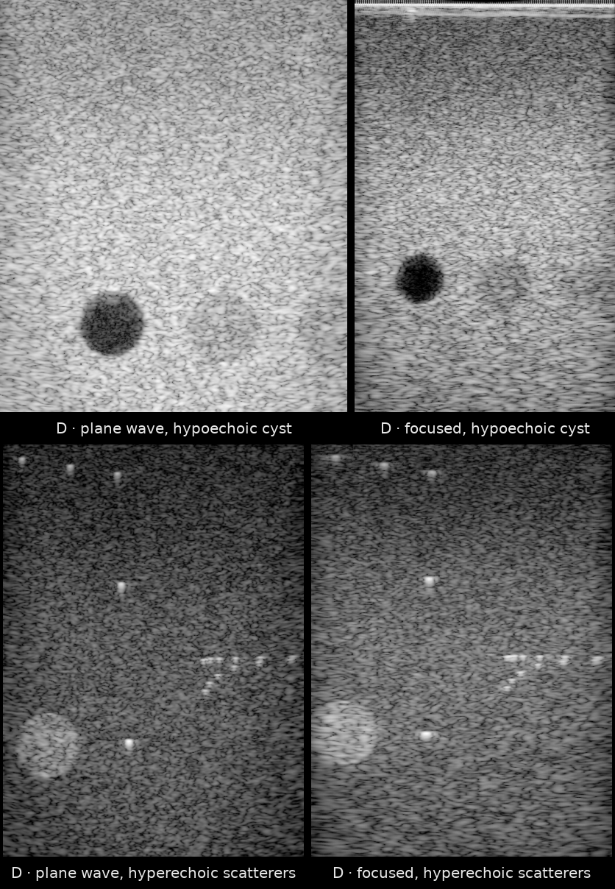

# USTB - Phantom (Alpinion L3-8, PULSE Lab, Johns Hopkins University)



*First frames of all four acquisitions, reconstructed from the raw channel data with `reconstruct.py`. Top: [`JHU_Alpinion_L3-8_CPWC_hypoechoic`](https://huggingface.co/datasets/nvidia/Open-H-RF/blob/main/jhu-pulselab/D_alpinion_phantom/JHU_Alpinion_L3-8_CPWC_hypoechoic.hdf5), [`JHU_Alpinion_L3-8_FI_hypoechoic`](https://huggingface.co/datasets/nvidia/Open-H-RF/blob/main/jhu-pulselab/D_alpinion_phantom/JHU_Alpinion_L3-8_FI_hypoechoic.hdf5). Bottom: [`JHU_Alpinion_L3-8_CPWC_hyperechoic_scatterers`](https://huggingface.co/datasets/nvidia/Open-H-RF/blob/main/jhu-pulselab/D_alpinion_phantom/JHU_Alpinion_L3-8_CPWC_hyperechoic_scatterers.hdf5), [`JHU_Alpinion_L3-8_FI_hyperechoic_scatterers`](https://huggingface.co/datasets/nvidia/Open-H-RF/blob/main/jhu-pulselab/D_alpinion_phantom/JHU_Alpinion_L3-8_FI_hyperechoic_scatterers.hdf5). Panels are scaled to a common height per row, not to a common physical scale.*

## Dataset Description

Part of the **UltraSound ToolBox (USTB) Channel Capture Collection** (see the [PULSE Lab collection card](../README.md) and the [USTB collection card](../../oslo/README.md)).

**Data owner: Johns Hopkins University (JHU).** The data were acquired by Muyinatu A. Lediju Bell and Ole Marius Hoel Rindal at the Photoacoustic & Ultrasonic Systems Engineering (PULSE) Lab, JHU, on the PULSE Lab's Alpinion E-Cube 12R research scanner.

Phantom channel-capture data of a CIRS General Purpose Ultrasound Phantom, acquired with an L3-8 linear-array probe. Hypoechoic and hyperechoic targets imaged with focused (FI) and coherent plane-wave compounding (CPWC) sequences.

These recordings have been publicly available through the UltraSound ToolBox (USTB) since 2017, with M. A. Lediju Bell and O. M. H. Rindal as authors. The University of Oslo (UiO) converted the data to the zea format and prepared it for Open-H-RF. Open-H-RF `v1.0` published these four acquisitions as `oslo/D_alpinion_phantom/`; they now live under `jhu-pulselab/`, and each file credits JHU in its `/metadata/credit` and `description` fields.

## Dataset Contributor(s)

- Johns Hopkins University (JHU), data owner
- Muyinatu A. Lediju Bell <mledijubell@jhu.edu>, PULSE Lab, JHU (primary contact)
- Ole Marius Hoel Rindal <omrindal@ifi.uio.no>, University of Oslo (UiO), Department of Informatics (data acquisition at the PULSE Lab; zea conversion)

## Dataset Creation Date

Acquired at the PULSE Lab, JHU, in 2017. Packaged in zea format on 06/23/2026.

## License / Terms of Use

[Creative Commons Attribution 4.0 International (CC BY 4.0)](https://creativecommons.org/licenses/by/4.0/legalcode.en). Retain attribution and identify modifications when reusing the data. This data was first released with the USTB proceedings paper (Rodriguez-Molares et al., *The UltraSound ToolBox*, IEEE IUS 2017, doi:[10.1109/ULTSYM.2017.8092389](https://doi.org/10.1109/ULTSYM.2017.8092389)). Attribution under CC BY 4.0 means crediting the PULSE Lab, Johns Hopkins University, and citing the above paper (see [Citation](#citation)).

## Intended Usage

Generalized reconstruction and image-quality assessment on a second hardware platform (RFP task 6.1); cross-vendor robustness studies. (Open-H-RF RFP task 6.1 Generalized Reconstruction).

## Dataset Characterization

- **Data Collection Method:** phantom
- **Labeling Method:** Derived (known phantom target types).
- **Acquisition system:** probe(s) L3-8; element positions stored in `/probe/probe_geometry` (meters); center frequency, sampling frequency and sound speed stored per acquisition in `/scan` (see per-sample feature table).

## Processing the Dataset

The example acquisition can be processed with the `pipeline.yaml` definition in this folder and the [zea library](https://github.com/tue-bmd/zea).

`zea` streams the data from the Hugging Face Hub and processes it according to the pipeline. You can try it out with the following command:

```bash
zea process \
  --dataset hf://nvidia/Open-H-RF/jhu-pulselab/D_alpinion_phantom/JHU_Alpinion_L3-8_CPWC_hypoechoic.hdf5 \
  --config hf://nvidia/Open-H-RF/jhu-pulselab/D_alpinion_phantom/pipeline.yaml
```

This `pipeline.yaml` holds the pipeline and display window of that acquisition. To process all four acquisitions, use the USTB collection's `reconstruct.py` [script](https://github.com/open-h/Open-H-RF/blob/main/datasets/oslo/reconstruct.py) from the [Open-H-RF GitHub repository](https://github.com/open-h/Open-H-RF) with the [zea library](https://github.com/tue-bmd/zea); it streams the data from the Hugging Face Hub. To avoid keeping two copies, the script and its `pipeline*.yaml` and `parameters.yaml` files live only in the USTB collection folder, [`oslo/`](../../oslo/README.md).

## Dataset Format

[zea v0.1.6](https://github.com/tue-bmd/zea)

All acquisitions are stored in the **zea** HDF5 file format. Each `.hdf5` file is a single acquisition with raw channel data `/data/raw_data` of shape `(n_frames, n_tx, n_ax, n_el, n_ch)` and a fully populated `/scan` group describing the transmit sequence (delays, focus distances, steering angles, apodization, timing). Data type: RF (n_ch=1). No demodulation or decimation was applied during packaging beyond conversion from the USTB Ultrasound File Format (UFF) to zea; RF data is demodulated inside the reconstruction pipeline.

## Dataset Quantification

**Current Open-H-RF release:** 4 HDF5 files; 466.42 MB (466,419,712 bytes) stored; root `zea_version` **0.1.6**. Sizes include all HDF5 contents and use decimal units (MB = 10^6 bytes, GB = 10^9 bytes, TB = 10^12 bytes), not decoded-array memory or original-source download sizes.

- **Number of acquisitions:** 4
- **Total channel-capture frames:** 4
- **Train / validation / test split:** not predefined (research dataset).
- **Stored HDF5 size:** 466.42 MB (466,419,712 bytes).

Per-acquisition summary:

| Acquisition | frames | transmits | samples | elements | n_ch | fs (MHz) | fc (MHz) | size (MB) |
|---|---|---|---|---|---|---|---|---|
| `JHU_Alpinion_L3-8_CPWC_hyperechoic_scatterers` | 1 | 21 | 4352 | 128 | 1 | 40.0 | 6.00 | 40.89 |
| `JHU_Alpinion_L3-8_CPWC_hypoechoic` | 1 | 21 | 4352 | 128 | 1 | 40.0 | 6.00 | 40.96 |
| `JHU_Alpinion_L3-8_FI_hyperechoic_scatterers` | 1 | 256 | 3474 | 128 | 1 | 40.0 | 6.00 | 192.35 |
| `JHU_Alpinion_L3-8_FI_hypoechoic` | 1 | 256 | 3474 | 128 | 1 | 40.0 | 6.00 | 192.22 |

Per-sample feature table:

| Field | Shape | Dtype | Units | Description |
|---|---|---|---|---|
| `data/raw_data` | `(n_frames, n_tx, n_ax, n_el, n_ch)` | float32 | a.u. | Raw pre-beamformed RF channel data |
| `scan/sampling_frequency` | `scalar` | float32 | Hz | A/D sampling frequency |
| `scan/center_frequency` | `scalar` | float32 | Hz | Transmit pulse center frequency |
| `scan/demodulation_frequency` | `scalar` | float32 | Hz | Demodulation (carrier) frequency |
| `scan/sound_speed` | `scalar` | float32 | m/s | Assumed medium speed of sound |
| `scan/initial_times` | `(n_tx,)` | float32 | s | A/D start time per transmit |
| `scan/t0_delays` | `(n_tx, n_el)` | float32 | s | Per-element transmit fire times |
| `scan/tx_apodizations` | `(n_tx, n_el)` | float32 | - | Per-element transmit apodization |
| `scan/focus_distances` | `(n_tx,)` | float32 | m | Focus distance per transmit (0 = plane wave) |
| `scan/polar_angles` | `(n_tx,)` | float32 | rad | Transmit steering (polar) angle |
| `scan/transmit_origins` | `(n_tx, 3)` | float32 | m | Transmit beam origin (x, y, z) |
| `probe/probe_geometry` | `(n_el, 3)` | float32 | m | Element positions (x, y, z) |
| `metadata/credit` | `scalar` | string | - | Attribution: "Acquired by M. A. Lediju Bell and O. M. H. Rindal at the PULSE Lab, Johns Hopkins University (JHU). Owned by JHU." |

## Subject Metadata

No human or animal subjects. Targets: hypoechoic/hyperechoic inclusions and point scatterers in a CIRS General Purpose Ultrasound Phantom. Scanner: Alpinion E-Cube 12R (PULSE Lab, JHU). Probe: L3-8 linear array (128 elements).

## Data Validation

A Delay-And-Sum `zea.Pipeline` (`cast -> demodulate -> delay-and-sum beamform -> envelope detect -> normalize -> log compress`) reconstructs every acquisition as a portable check that the recorded geometry and timing are correct (see [Processing the Dataset](#processing-the-dataset)).

## Known Issues

Mixed transmit schemes across files (CPWC / FI).

## Ethical Considerations

Phantom acquisitions; no human or animal subjects. No ethical considerations beyond standard laboratory practice.

## Citation

Please credit the PULSE Lab, Johns Hopkins University, as the owner of this data, and cite:

A. Rodriguez-Molares, O. M. H. Rindal, O. Bernard, A. Nair, M. A. Lediju Bell, H. Liebgott, A. Austeng and L. Løvstakken, "The UltraSound ToolBox," in *2017 IEEE International Ultrasonics Symposium (IUS)*, 2017, pp. 1–4. doi:[10.1109/ULTSYM.2017.8092389](https://doi.org/10.1109/ULTSYM.2017.8092389)
